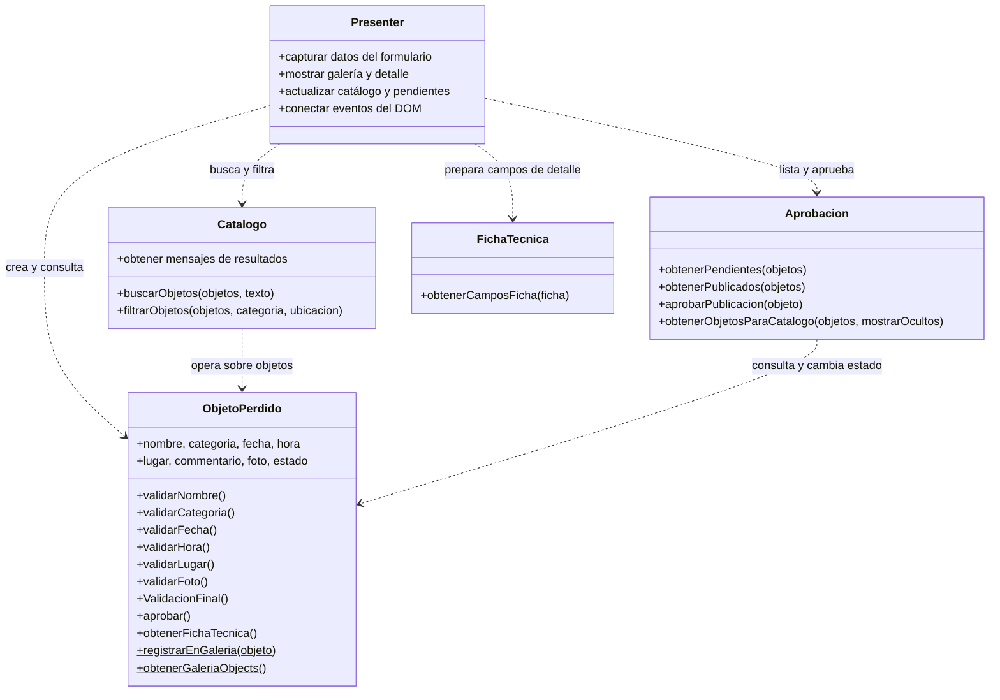

# Arquitectura de la aplicación

## Resumen

La aplicación de objetos perdidos está construida como una aplicación web cliente con JavaScript en módulos. Su diseño separa parcialmente la interfaz de las reglas de negocio: el DOM y los eventos se gestionan en `src/presenter.js`, mientras que el modelo y las operaciones de catálogo, aprobación y ficha se encuentran en módulos independientes bajo `src/`.

## Diagrama de clases y módulos

El diagrama muestra los módulos principales y sus dependencias. `Catalogo` y `Aprobacion` son módulos de funciones, no clases instanciables; aparecen como unidades funcionales para hacer visible su responsabilidad.

## Separación entre interfaz y lógica

- **Interfaz y coordinación:** `src/presenter.js` consulta elementos HTML, registra eventos, recoge los datos del formulario y actualiza la galería, el detalle y la lista de pendientes. También decide qué funciones de negocio invocar ante una acción del usuario.
- **Reglas del objeto:** `src/ObjetoPerdido.js` representa un reporte y contiene validaciones de nombre, categoría, fecha, hora, ubicación y foto. Mantiene el estado del reporte, que empieza como pendiente y pasa a publicado al aprobarse.
- **Catálogo:** `src/Catalogo.js` implementa búsqueda por nombre, filtros por categoría y ubicación y los mensajes para resultados vacíos.
- **Aprobación y publicación:** `src/Aprobacion.js` selecciona reportes pendientes o publicados y permite aprobarlos. El catálogo muestra por defecto los publicados; existe una opción para incluir los ocultos.
- **Presentación de la ficha:** `src/FichaTecnica.js` transforma los datos de una ficha en etiquetas y valores para que el presenter los renderice.

Esta separación permite probar las reglas y funciones de catálogo sin depender directamente del DOM. Sin embargo, `presenter.js` también contiene la construcción de HTML y la coordinación del flujo, por lo que actúa como presentador y capa de vista en el mismo módulo; no hay un framework de UI ni una capa de servicios/repositorios.

## Flujo principal

1. El presenter recoge el formulario y crea un `ObjetoPerdido`.
2. El modelo valida los campos. Si son válidos, el presenter registra el objeto en la galería en memoria y muestra la confirmación.
3. El módulo de aprobación identifica los pendientes. Al aprobar uno, el estado del objeto cambia a `Publicado`.
4. El presenter vuelve a calcular el catálogo: aplica visibilidad, filtros y búsqueda, y renderiza las tarjetas. Al seleccionar una tarjeta solicita el detalle y obtiene las etiquetas mediante `FichaTecnica`.

## Alcance actual

Los datos se guardan en `ObjetoPerdido.galeria`, una colección estática en memoria del navegador. No se observa una base de datos, API ni almacenamiento persistente; al reiniciar o recargar la aplicación, los reportes registrados durante la sesión no se conservan. El proyecto incluye pruebas unitarias para el modelo y los módulos funcionales.
